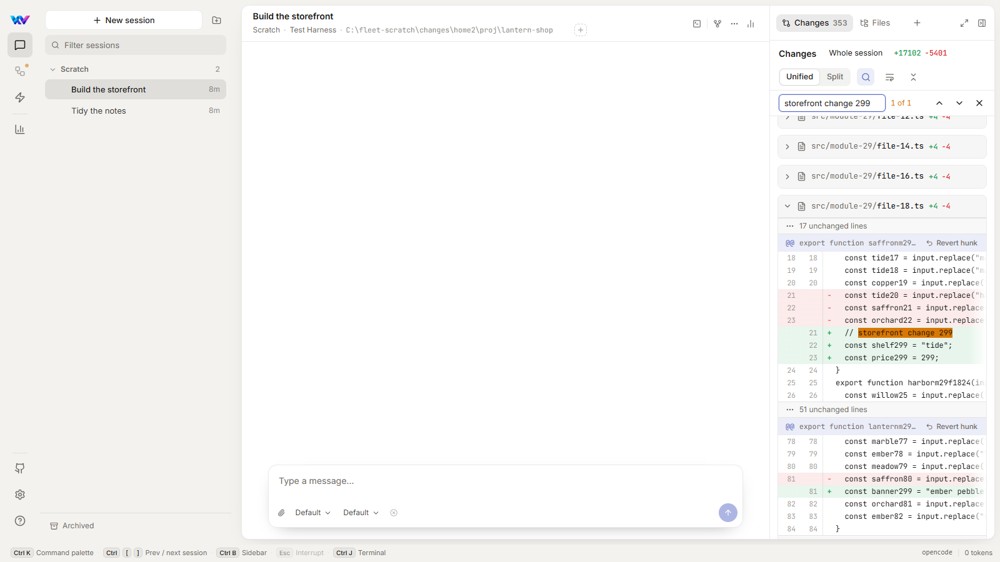
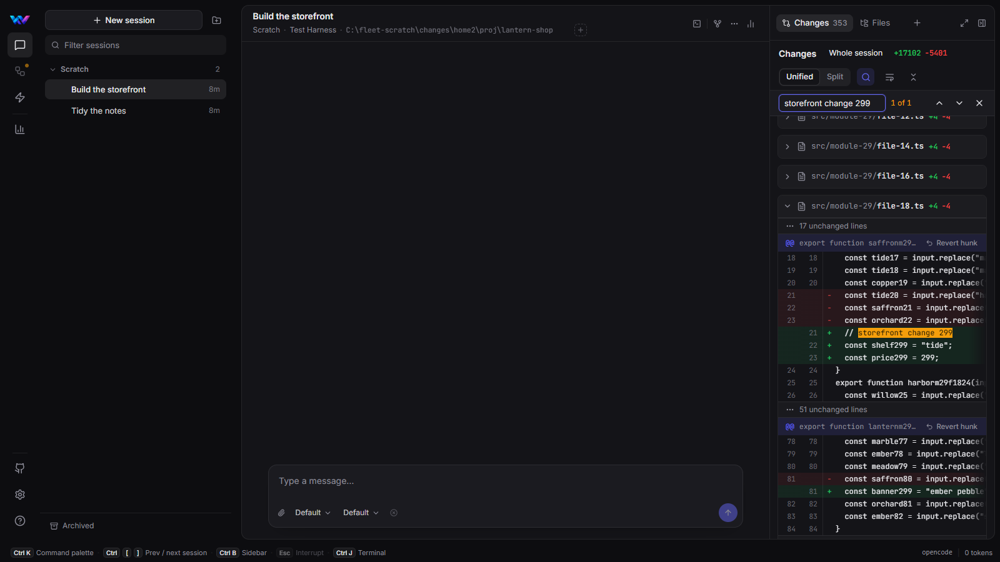

feat(changes): a Find button and server-side search; Changes keeps up while the agent writes; diffs draw as they come into view

Stacked on `fix/changes-sluggish`: merge that first, then this one has only its own five commits.

## What the user chose, and the prior art followed

- **Find: A + C.** A Find button (magnifier) in the Changes header opens the find bar; Ctrl+F inside Changes still does. Find now asks the machine which changed files hold the text and loads only those. Before, it loaded every file of the change set to search it.
- **Live updates: as T3 Code and OpenChamber do.** Both refresh mid-turn after each agent action, never waiting for the agent to pause. OpenChamber gathers events in a fixed 250 ms window that later events join rather than restart. Fleet's 500 ms debounce restarted on every `files.changed`, so a run of edits less than half a second apart left Changes unchanged until the agent stopped.
- **Large diffs: as T3 Code and OpenChamber do.** Both collapse most files and fetch and draw a file only once it is open and near the viewport (T3: IntersectionObserver with a 600 px margin; OpenChamber: 300 px), keeping it drawn after that. Fleet drew every open file's lines up front, which made opening a session with changes about a third slower.

## Changes

- `GET /api/sessions/{id}/diffs/search?q=` runs one `git grep -I -i -F -c` over the changed paths in the working tree and one in the baseline (a deleted file's text lives only there). It returns the files that hold the text, any case, with a line count, as paths relative to the session's folder. Find asks it 120 ms after the last keystroke (OpenChamber's find debounce) and loads only those files.
  - A machine that can't answer (an older Fleet without the endpoint, or git failing) falls back to the old search over every file, so a fleet of mixed versions keeps working.
  - A query with non-ASCII letters falls back too: git's `-i` folds ASCII only.
- `use-diffs`: `files.changed` opens a 250 ms window that later edits join instead of restart. A refresh still running when the next window ends is followed by one more, never run alongside it (a big repository's list takes seconds).
- `ChangesReview`: an open file's diff is fetched and drawn once its section comes within 600 px of the visible part of the review, and stays drawn after that.
  - Until then, and while its diff loads, it holds about its height, so the files below it don't all slide into view at once.
  - A find match or the changed-files card draws the file it goes to.
  - Without IntersectionObserver, every file draws at once, as before.

## Measured (scratch Fleet, invented 353-file change; medians of 3 interleaved runs against `fix/changes-sluggish`)

| Scenario | fix/changes-sluggish | this PR |
|---|---|---|
| Find "storefront change 299": every match ready | 38.6 s | 1.6 s |
| Find: file requests / git processes | 345 / 2,375 | 1 (+1 search) / 15 |
| 20 saves 400 ms apart: Changes refreshed while they went on | 0 times | 19 times |
| Open the 353-file session: diff lines drawn / file requests / git processes | 300 / 6 / 47 | 140 / 3 / 26 |
| Open the 353-file session: everything settled | 1.56 s | 1.27 s |
| Open the 3-file session: diff lines drawn | 175 | 97 |

The live-update cost: refreshing during the run took 142 git processes (5.3 s of git over the 8 s run), against 13 when Changes waited for the agent to stop. That's the price of keeping up, as in OpenChamber; one refresh runs at a time.

## Tests (each failed first)

- `GitDiffServiceTests`: search greps both sides over the changed paths; grep exit 1 means no matches; a git failure means "can't say".
- `SessionDiffEndpointTests`: search with a real repository in a subfolder (any case, untracked files, nothing outside the folder, empty `q` → 400).
- `ChangesReview`: the Find button; only the files the machine names load; the fallback; a file draws only once near and stays drawn.
- `use-diffs`: edits 200 ms apart for 2 s refresh during the run, one at a time.

## Screenshots (real app, scratch Fleet)

| Find from the header button: one search, one file loaded (light) | Dark |
|---|---|
|  |  |

🤖 Generated with [Claude Code](https://claude.com/claude-code)
