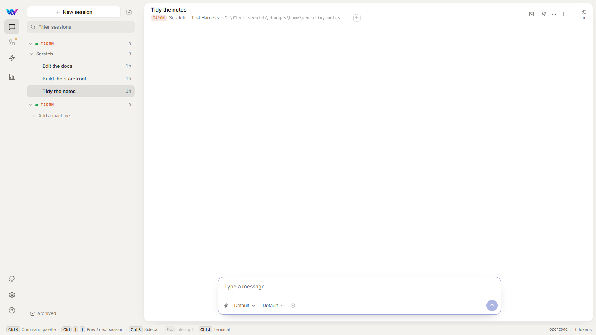
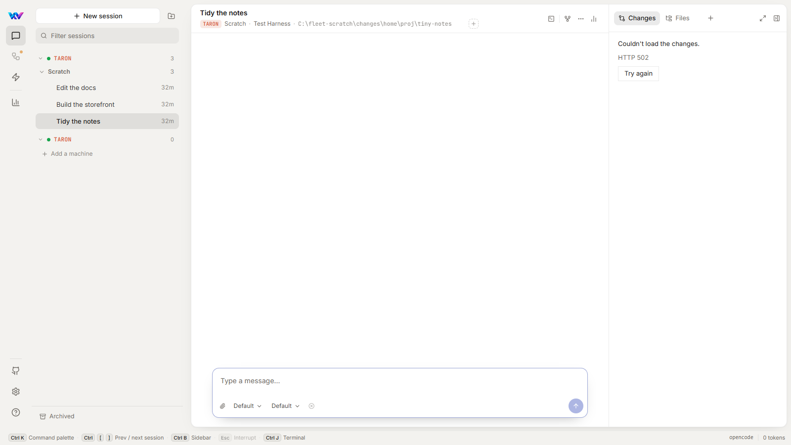
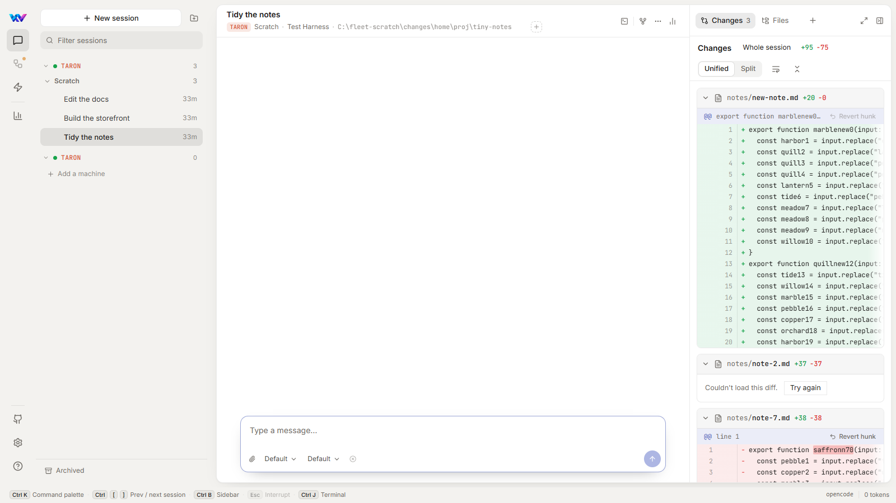
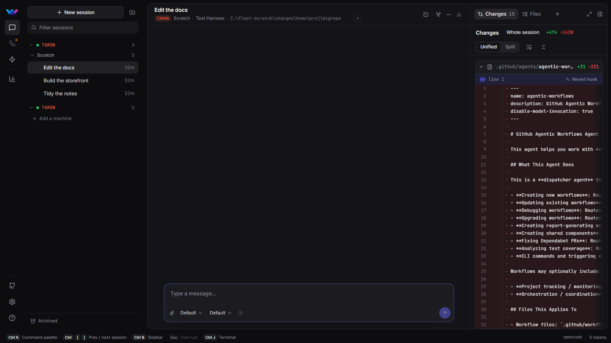

fix(changes): a file's diff asks git about that file only; Changes can't hold up the app, and a failure says so

## Why

Changes felt sluggish and sometimes "wouldn't load". Measured on scratch Fleets (invented repositories plus a 58,000-file public repository, medians of 3 interleaved runs):

| Scenario | main | this PR |
|---|---|---|
| Big repository: first diff drawn | 9.3 s | 2.8 s |
| Big repository: git time to open Changes | 31.3 s | 4.0 s |
| Large diff (353 files): first diff drawn | 3.0 s | 1.9 s |
| Switch session: all requests settled | 10.8 s | 2.8 s |
| Find (Ctrl+F) on the large diff: another request's wait meanwhile | 71 s | 15 ms |
| Session on another machine: first diff (from click) | 2.5 s | 1.3 s |
| `/diffs` list requests per session opened | 2 | 1 |

## Causes and fixes

- **`GET /diffs/file` re-listed every change in the repository** (`diff --numstat`, `--name-status`, `ls-files --others`) to return one file (`GitDiffService.ComputeFileDiffWithContentAsync`). This was harmless while Changes was a list you clicked one file at a time. Since the review panel (#862) opens 8 files at once and find (#918) loads them all, it cost about 2 s of git per file in a big repository. Git is now asked about that path only (a literal pathspec), and a path outside the session's folder is refused before running git.
- **Find sent all 345 file requests at once**, and the browser's 6 connections per server then queued every other request (opening a session, sending a message) for over a minute. Now at most 4 file diffs are in flight per machine.
- **Opening a session ran `/diffs` twice** (the right panel's and the session page's). They now share one request (`fetchDiffs({ join: true })`); fetches after an edit or a revert never join an older one.
- **A failed `/diffs` showed "No changes in this session yet."**, and the empty-panel rule kept the panel shut. It now opens on "Couldn't load the changes" with Try again. A file whose diff failed has Try again instead of staying broken.

Each fix has a test that failed first: `GitDiffServiceTests` (pathspec, outside-folder), `use-file-diff-contents` (4 in flight), `use-diffs` (shared request, fresh after edits), `ChangesCanvas` (error + Try again), `ChangesReview` (file retry), `panel-content` (a failure is something to show).

## Screenshots (real app, scratch Fleet)

| main: `/diffs` fails (forced 502), panel stays shut | this PR: the panel opens on the error |
|---|---|
|  |  |

| A file's diff failed: Try again | Big repository, dark |
|---|---|
|  |  |

## Rerun the measurements

`tests/changes-bench` (README.md): `fleet.ts` starts an isolated scratch Fleet (own profile, port and database, test harness), `setup.ts` builds the invented repositories and sessions, `bench.ts` / `remote.ts` time the scenarios with Playwright and read each git process's time from `GIT_TRACE2_EVENT`, and `summarize.ts` computes the medians. The full report is `mockups/changes-sluggish/report.html`.

Not in this PR (it needs a decision): find still loads every file to search it (53 s for the 353-file diff, with the app now responsive meanwhile). The report proposes a find button and/or a server-side `/diffs/search`.

🤖 Generated with [Claude Code](https://claude.com/claude-code)
