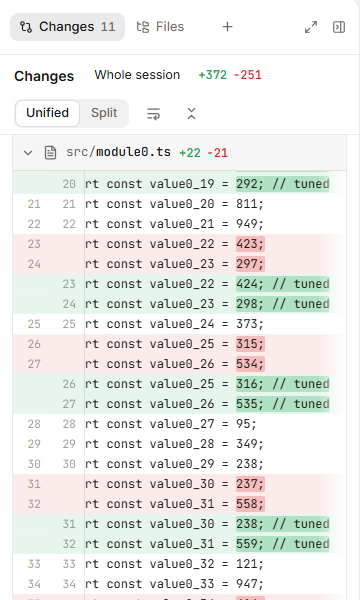
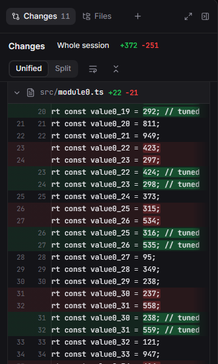

## What was slow

With a diff open in the Changes panel, typing in the composer got about 4x slower than in v0.60.0. Sending a prompt, and
four sessions streaming while you read a long one, got slower the same way.

The Changes review panel (#862) gives every diff line two `position: sticky` line-number cells, inside a horizontal
scroller per hunk. For 11 changed files that is 1,569 sticky boxes. Every repaint of the page (each keystroke, each
caret blink, each streamed token in the session list) re-layerized and re-hit-tested all of them, even with the panel idle.

A Chrome trace of typing 28 characters at 4x CPU, same seeded session, same changes:

| | v0.60.0 | main |
|---|---|---|
| Layerize | 162 ms | 767 ms |
| HitTest | 8 ms | 248 ms |
| Commit | 23 ms | 201 ms |
| Long tasks | 0 | 18 |

## The fix

Line numbers are static until their hunk is scrolled sideways. One passive, capture-phase scroll listener on the review
root toggles `.rscroll--scrolled` on that scroller, and only there do the numbers become `position: sticky`. At
`scrollLeft: 0` a static number sits exactly where a sticky one did, so nothing moves. Scroll a long line sideways and
its numbers still stay put.

 

The whole window, with the long line's hunk scrolled sideways: [fix-light.png](https://raw.githubusercontent.com/pgermishuys/weave-fleet/9705bbec9c8683df3198c5c0557601820db53a04/mockups/changes-sticky-gutters/fix-light.png)

## Measured

`tests/snappiness` (on branch `snappiness/check`): a scratch Fleet in test-harness mode, seeded with 150 invented
sessions; the long session's project has 10 edited files and one new one. Chromium, CPU 4x, the same server, client
built from origin/main without and with this change, 2 interleaved rounds, 8 samples each:

| | before median / p95 | after median / p95 |
|---|---|---|
| Keystroke to paint | 134 / 384 ms | 50 / 78 ms |
| INP while typing | 116 / 120 ms | 72 / 96 ms |
| Send a prompt, until settled | 1632 / 1770 ms | 1156 / 1698 ms |
| Long tasks while 4 sessions stream (per 6 s) | 1131 / 1738 ms | 165 / 529 ms |
| Keystroke to paint while 4 sessions stream (p95) | 174 / 407 ms | 74 / 142 ms |

## Test

`ChangesReview.test.ts`: "keeps line numbers in place only in a hunk scrolled sideways" (failed before the change).

🤖 Generated with [Claude Code](https://claude.com/claude-code)
